# Recipe

Settings per step, taken from the project notes and the actual training/generation configs. Anything not confirmed in those sources is marked **TBD**.

## Common

| Item | Value |
|---|---|
| Task | Pick up the blue block and put it in the gray bowl |
| Success criterion | Block is inside the bowl when the gripper opens |
| Robot | SO-101 arm (5-DoF + gripper) |
| Camera | One front camera, 640×480 (policy uses front camera only). Frame rate: policy (π0.5) datasets 30 fps; raw capture used as Predict/IDM input 15 fps |
| Real data | 20 real demonstrations, all with the block on the **left**, LeRobot format (20 episodes / 8,993 frames). Never extended. |
| Right-side spots | 20 fixed spots (R00–R19), mirrored from the left demos and moved until IK passes (position ≤2 mm, rotation ≤10°); 32 mm spacing, within 0.306 m of the base, outside 90 mm of the bowl. Used for Steps 2–5 generation and for the official right20 eval (same 20 spots for every step). |

### What it looks like

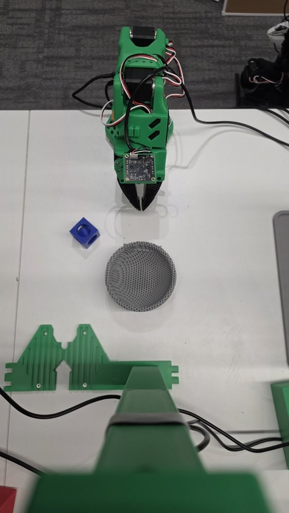
*Real 3D-printed workspace seen from above: arm at the top, blue block on the left, gray bowl in the center, front-camera mount at the bottom.*

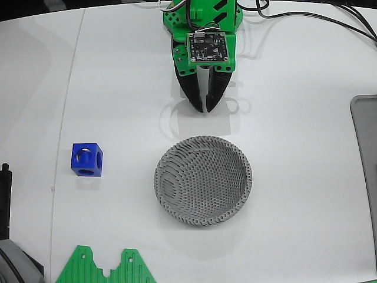
*Front camera (640×480) at the start of a real episode.*

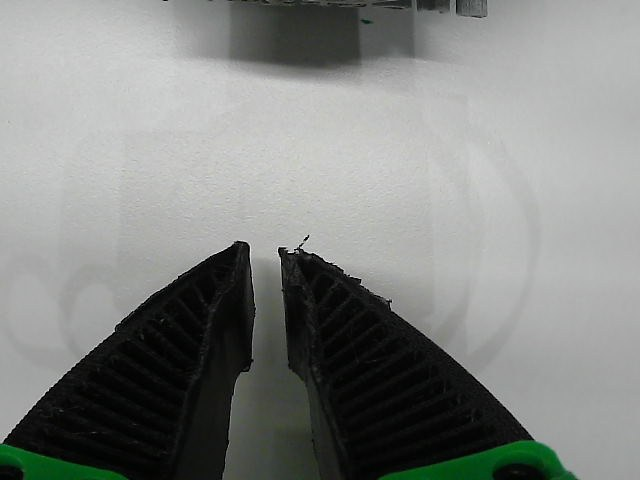
*Wrist camera at the start of a real episode. The wrist starts rolled (recorded at wrist_roll ≈ −81°), so the wrist view is tilted relative to the table; the sim start pose is ≈ −86° (about 5° more) and was left as is. The policy and IDM use the front camera only.*

## π0.5 training (policy; same recipe for every step)

| Item | Value |
|---|---|
| Base | `lerobot/pi05_base` (LeRobot) |
| Steps | 10k |
| Batch | 32 |
| LR | 2.5e-5, cosine |
| Precision | bf16 |
| Action chunk | 50 |
| Inputs | front camera only |

Evaluated π0.5 mixes (official right20, 2026-11-06). Do not equate pipeline generation counts with these mixes:

| Model | Training mix | Notes |
|---|---|---|
| S1 | real left 20 only | 20 ep |
| S2 | real + predict100 | Evaluated Step 2 policy. Pipeline generation was 20 spots × 3 seeds = 60 clips; that 60 is not the evaluated mix. |
| S3v2 | real + sim 171 | 191 ep (real_left 20 + sim 171) |
| S4v3r10 | real + gen10 | Evaluated Step 4 policy. Pipeline generation was also described as 20×3 clips. |
| S5 | real + Transfer 171 | 191 ep (real_left 20 + 171 Transfer clips that passed QC) |

Earlier / not the official eval: **S4v2** = 28 ep (real_left 20 + 8 right Predict clips). Used in informal 2026-11-03 tries only.

> "Predict post-training" (training the Cosmos video model) and "π0.5 training" (training the robot policy) are separate jobs.

## Step 1 — baseline

π0.5 on real_left 20 only. Official right20 (2026-11-06): 0/20 place success, 0/20 right-side motion. S1 never turned right.

## Step 2 — Cosmos Predict 2.5 + IDM

- **Predict post-training:** Cosmos Predict 2.5 2B video2world, full fine-tune (no LoRA), on 23 real_left clips (5,701 frames, 640×480, 93-frame windows; content 15 fps, labelled 16 fps). Prompt `"Pick_blue_block_and_put_it_gray_bowl"`, batch 1, lr 2^-14.5 (≈4.3e-5), warmup 1000, 6000 iterations. Generation for the 60 right-spot clips used the iteration-3000 weights.
- **Conditioning:** first front frame of each real left demo with the block removed and re-composited at each of the 20 right spots (with measured shadow).
- **Generation:** 20 right spots × 3 seeds = 60 clips. This is the pipeline generation count, not the evaluated π0.5 mix.
- **IDM labeling:** IDM trained on real_left 20 only (video → joint values). 
- **IDM (architecture):** GR00T-Dreams IDM: SigLIP2-L/16-256 vision encoder (fine-tuned), 4 self-attention layers, 8-layer flow-matching DiT action head (1024 hidden, 16 heads), 16-step action chunks. Initialized from the public SO-100 IDM and fine-tuned on the 20 real left episodes (15 fps, front camera) for 20k steps.
- **IDM labels (60 generated clips):** IDM `shoulder_pan` never went below −7.5°, while IK needs −18° to −66°; 38/60 clips never reached the block.
- **π0.5 training (S2, evaluated):** real + predict100. Official right20 (2026-11-06): 0/20 place success, 0/20 right-side motion. S2 never turned right (same as S1 on this eval).

### What it looks like

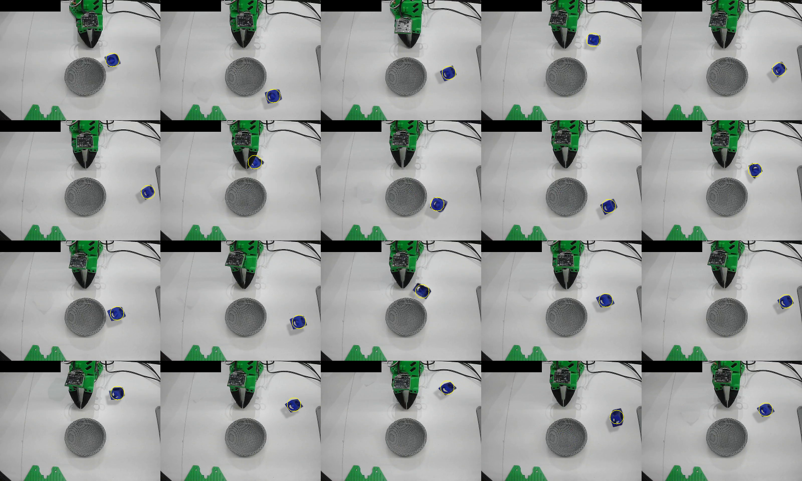
*Tiled grid of the 20 conditioning first frames: block removed from the real left frame and composited at each right spot.*

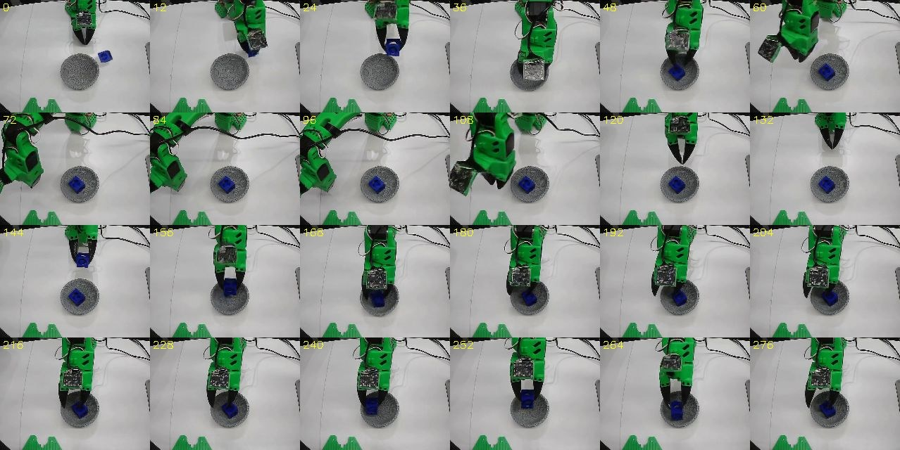
*Frame sheet of one Step 2 Predict clip at a right spot. Across all 60 Step 2 clips the IDM labels never turned shoulder_pan below −7.5° (IK needs −18° to −66°), so the labels point the wrong way even when the video looks plausible.*

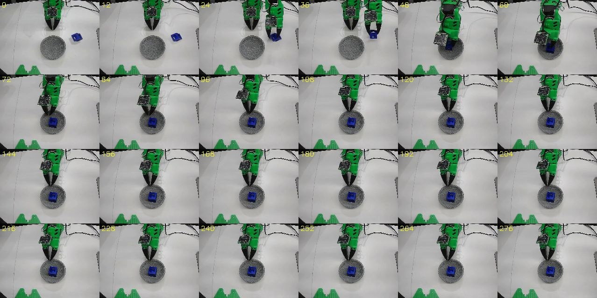
*Failure: a second, overlapping "ghost" arm appears in a Step 2 clip. 34 of 60 clips showed a ghost arm or a teleporting block (visual check).*

## Step 3 — Isaac Sim + NuRec, MimicGen

- **Scene:** NuRec 3DGS (3DGUT) background of the 3D-printed workspace; COLMAP → 3DGUT (MCMC) → USDZ → Isaac Sim 6.0.1. Camera re-calibrated to the real one.
- **Replay gate:** real_left 20 replayed in sim with joint values. Block placed at the center of the open jaw gap: 19/20 lift. The 19 passing demos are the MimicGen seeds.
- **Generation:** 19 seed demos × 20 right spots = 380 attempts. Grasp segment transformed relative to the block; place segment follows the bowl; inside 75 mm of the bowl the gripper stays ≥63 mm above the table.
- **QC (keep rule):** block inside bowl on release, rotation ≤10°, position ≤8 mm, bowl moved <10 mm and tilted <10°. **211/380 kept (55.5%).**
- **Render:** 211 episodes re-rendered from recorded states (front camera); frame 0 dropped and labels shifted by one frame.
- **Labels:** sim ground-truth joints (no IDM).
- **π0.5 training (S3v2):** real_left 20 + sim 171 = 191 ep. The 171 are the sim episodes whose Cosmos Transfer outputs (Step 5) passed auto-QC; 40 of 211 were excluded. S3v2 trains on the **raw sim renders** of these 171 (frame 0 dropped); S5 trains on their Transfer outputs.
- **Official right20 (2026-11-06):** 12/20 place success, 19/20 right-side motion.

### What it looks like (Step 3)

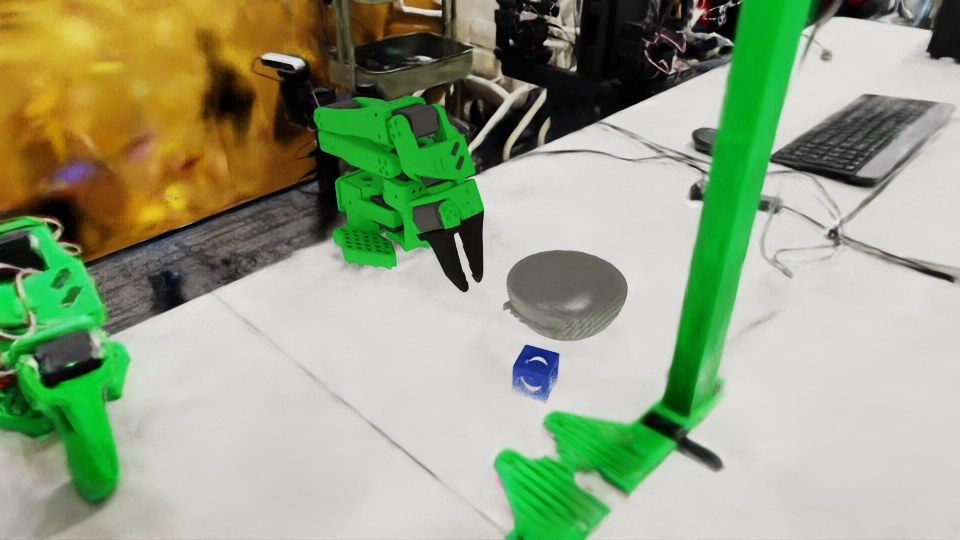
*Isaac Sim scene: SO-101, block and bowl over the NuRec 3DGS background of the real room.*

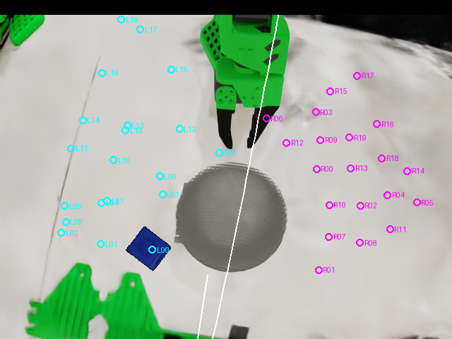
*The 20 right-side target spots (magenta) vs. the block positions of the 20 real left demos (cyan), drawn on the sim front view.*

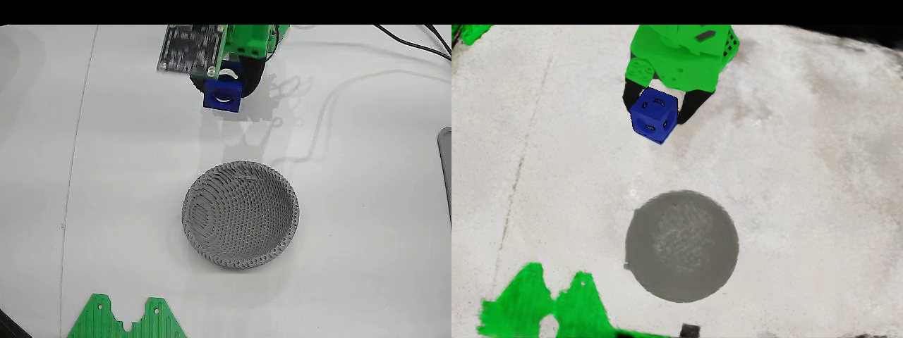
*Replay gate, pass: real (left) vs. sim replay of the same joint values (right); the sim block is lifted (100 mm).*

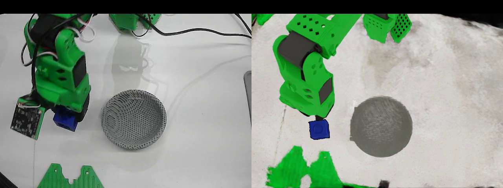
*Replay gate, fail: same arm path, but the gripper closes on empty space (6 mm lift). Rejected by the lift rule (>30 mm). Cause: the block position estimated from the real video was off; fixed by placing the block at the open-jaw center.*

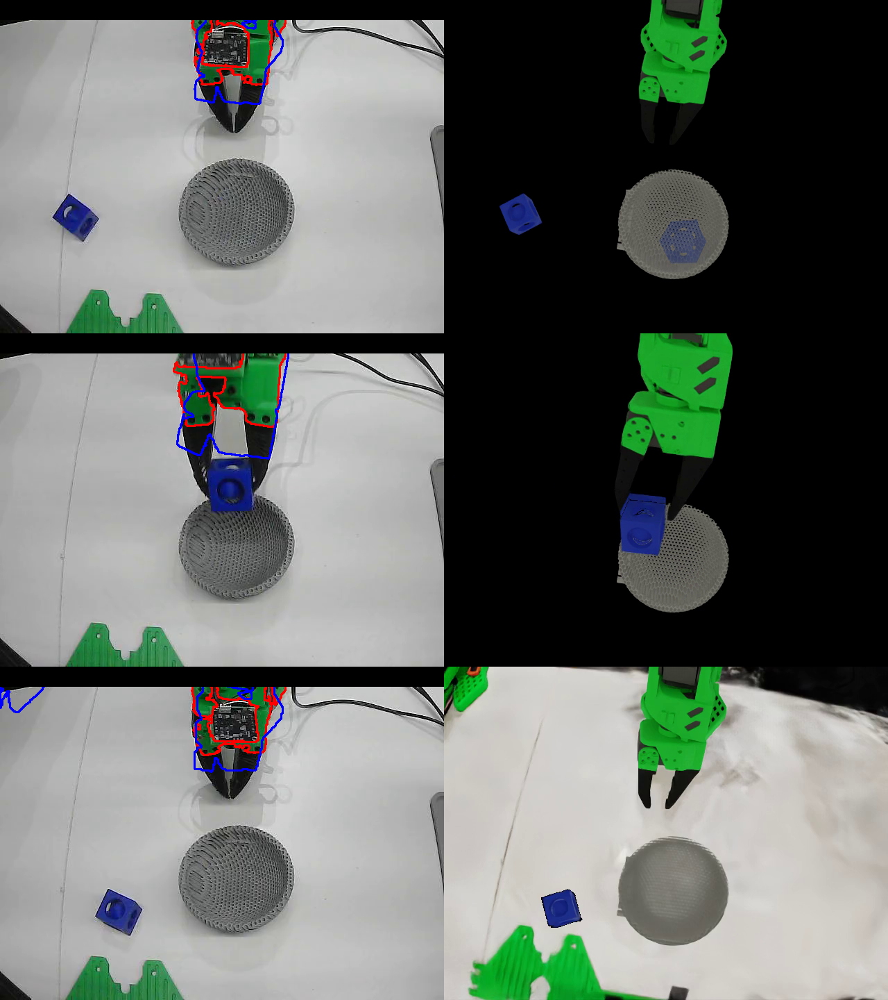
*Real arm mask (red) vs. sim arm mask (blue) on real frames, next to the sim renders: the arms agree to within about one link width.*

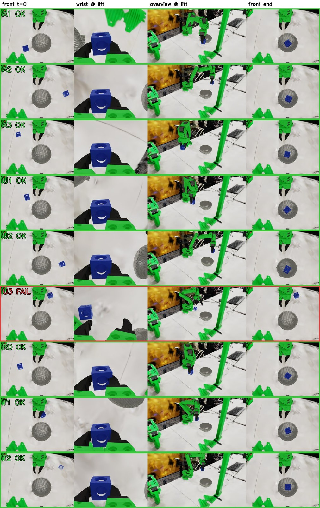
*Tiled grid from an earlier scripted-sim round (not the MimicGen data): per spot, front at t=0, wrist and overview at lift, front at the end. Green = block ended in the bowl, red = failure.*

## Step 4 — Predict re-post-trained on real + sim right, sim-fine-tuned IDM

- **Predict post-training:** Cosmos Predict 2.5 (2B) video2world, from base, on **103 clips** = 23 real_left clips + 80 Step 3 sim right clips (front, 640×480). Same recipe as Step 2 (full fine-tune, batch 1, lr 2^-14.5, warmup 1000), 480×640, 93 frames per clip, trained to 4000 iterations, saved every 500; generation used the **iteration-3500** weights (pilot 5/6 pass vs. 3/6 at 4000). Prompt gets the suffix "Simulation render.". The 23 real / 80 sim split is as named in the dataset; the split itself was **not verified**.
- **Pilot pass rule:** final block position error ≤30 px, plus limits on frames with no block blob / multiple blobs; ≥4 of 6 pilot clips must pass.
- **Generation:** image2world, prompt `"Pick_blue_block_and_put_it_gray_bowl. Simulation render."`, guidance 7, 35 sampling steps, 480×640, 185 output frames, autoregressive in 93-frame chunks with 1-frame overlap. 60 clips generated (20 spots × 3 seeds). This is the pipeline generation count, not the evaluated π0.5 mix.
- **IDM fine-tune:** the Step 2 IDM fine-tuned a further 10k steps, batch 32, lr 1e-4, cosine schedule, AdamW, on ~31k samples from 205 trajectories (real_left + sim right with sim joint labels; exact real/sim mix **undocumented**).
- **QC:** 60 generated → 20 passed auto-QC (38 failed) → 21 after visual review (one false fail recovered) → 20 after a second review (20 episodes / 7,400 frames). An earlier Step 4 policy, **S4v2**, used real_left 20 + 8 of these (28 ep); the 8 were chosen as clips with clean gripper open/close sequences (**inferred from the selection script, not documented**). S4v2 is not the official eval model.
- **Label fixes:** the label start is anchored to the real start state and blended into the IDM labels over 16 frames; the gripper is snapped to the real open/closed levels (37.18° / 1.67°) with hysteresis.
- **S4v2 training-set coverage (earlier policy, not the official eval):** the 8 right clips covered only 6 of 20 spots, pan −28° to −51° vs. −28° to −79° needed.
- **π0.5 training (S4v3r10, evaluated):** real + gen10.
- **Official right20 (2026-11-06):** 0/20 place success, 19/20 right-side motion. The turn started right but was too small to reach the block. Right-side motion is a binary flag (any rightward `shoulder_pan`), so 19/20 overstates S4v3r10 spatial competence. This is not the same failure as S2: Predict (S2) never rotated right; gen10 (S4v3r10) rotated but did not reach.

### What it looks like

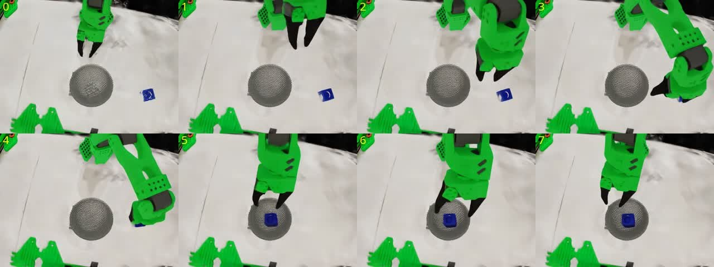
*Frame sheet of one Step 4 clip from the re-post-trained Predict: the arm turns right to the block, carries it and drops it in the bowl. Before re-post-training on sim right clips, Predict videos kept moving the arm over the bowl/left side instead (wrong direction).*

Known Step 4 failure (no image here): long clips are generated in 93-frame chunks, and near a chunk join a second blue block can appear and be picked again (block duplication). In the 60-clip run 20 passed and 38 failed auto-QC, mostly for duplication.

## Step 5 — Cosmos Transfer 2.5 of sim episodes

- **Input:** Step 3 sim right episodes (front, 10 fps) + edge control.
- **Settings (adopted):** Cosmos Transfer 2.5 (2B), edge control only, weight 1.0; 720p; 4 steps; guidance 3; seed 2025. Checkpoint variant **unconfirmed** (4 steps suggests the distilled one).
- **Prompt:** "A green robotic arm with a black gripper picks up a blue block next to a gray bowl on a plain white desk. The blue block and the gray bowl keep their exact shape and color; only the desk surface is changed to smooth plain matte white." (read from one episode spec; **assumed** identical for all episodes).
- **Pilot QC (3 clips):** block IoU 0.85 / 0.89 / 0.80, block center error 1–2 px.
- **Auto-QC rule:** block IoU ≥0.6, block center error ≤8 px, block detection ≥90% of frames, arm IoU ≥0.85, arm green fraction ≥0.6, brightness 120–175.
- **Bulk:** 211 transferred → **171 pass QC** / 40 fail. Long clips truncated at 93 frames; labels 1:1 with sim.
- **Labels:** sim ground-truth joints (no IDM).
- **π0.5 training (S5):** real_left 20 + 171 = 191 ep.
- **Official right20 (2026-11-06):** 14/20 place success, 19/20 right-side motion. Transfer is slightly stronger than S3v2 on place success (14/20 vs 12/20); both score 19/20 on right-side motion.

### What it looks like

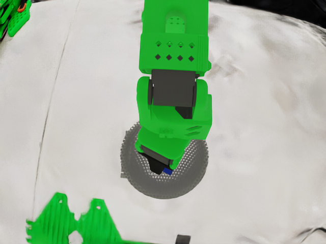
*NuRec 3DGS reconstruction rendered from the calibrated front camera.*

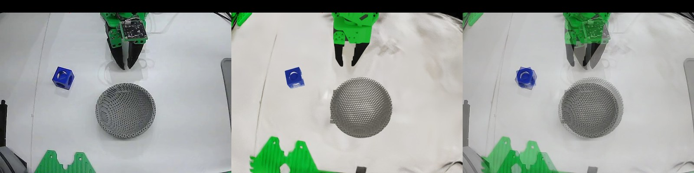
*Real front frame (left), Isaac Sim render over the NuRec background from the calibrated pose (middle), 50/50 blend (right).*

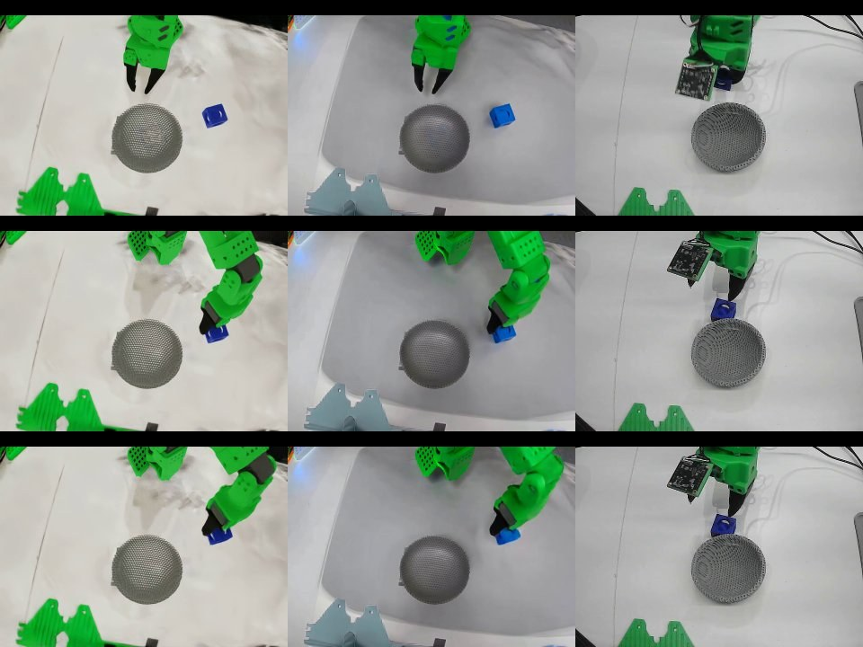
*Pass (adopted settings, white-desk prompt): rows = start / grasp / lift; columns = sim input, Transfer output, nearest real frame. Block stays blue and in place (block IoU 0.89 on this clip).*

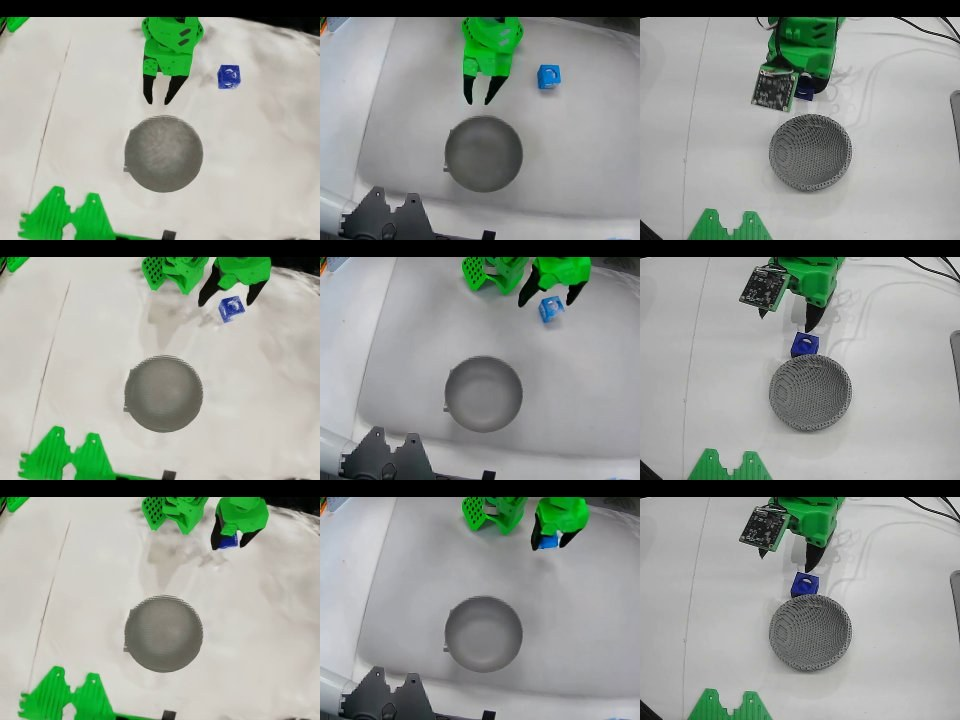
*Pass on a harder spot (block IoU 0.80).*

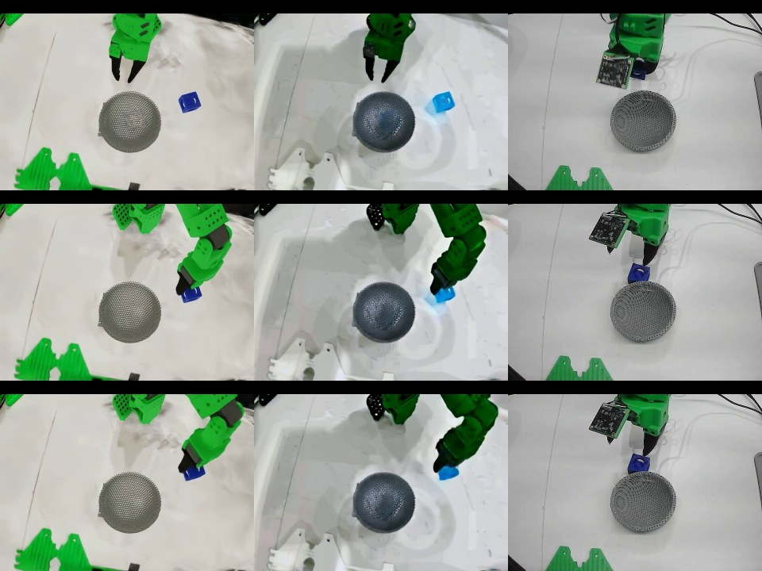
*Fail (earlier prompt variant): the block turns light blue and the scene background changes (block IoU 0.49). Rejected by the block-IoU / block-appearance check.*

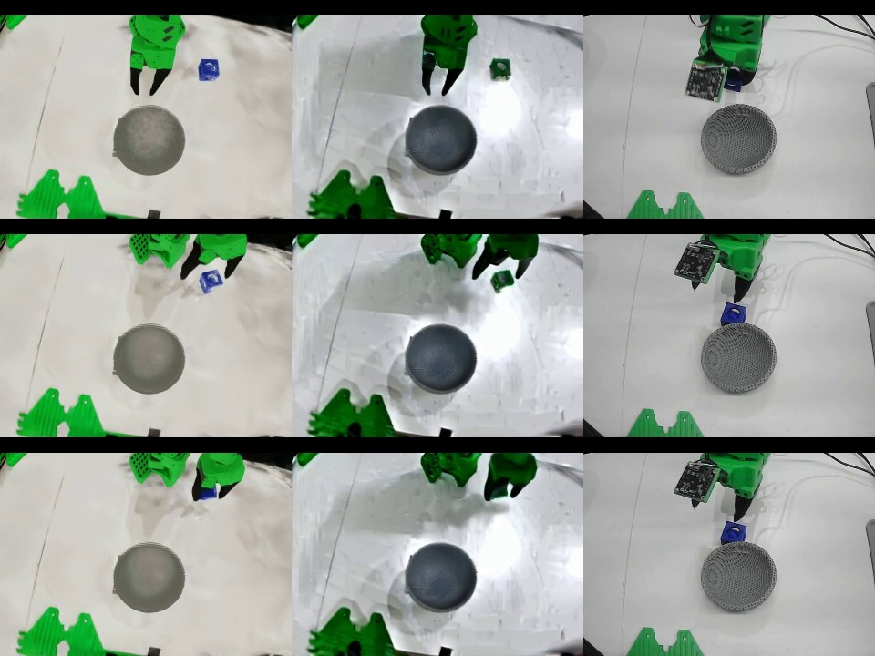
*Fail: the block turns green and fades mid-clip (block IoU 0.19).*

## Evaluation

Official locked formal right20 (2026-11-06). Same 20 right spots (R00–R19) for every step. Two axes: **place success** (block inside the bowl when the gripper opens) and **right-side motion** (binary: any rightward `shoulder_pan`).

| Step | Training data (20-spot right eval) | Success (place) | Right-side motion |
|---|---|---|---|
| S1 | real left 20 only | 0/20 | 0/20 |
| S2 | real + predict100 | 0/20 | 0/20 |
| S3v2 | real + sim 171 | 12/20 | 19/20 |
| S4v3r10 | real + gen10 | 0/20 | 19/20 |
| S5 | real + Transfer 171 | 14/20 | 19/20 |

- S1 and S2 never turned right (0/20 motion, 0/20 places).
- S3v2 (sim) and S5 (Transfer) are what actually placed (12/20 and 14/20), with right-side motion 19/20.
- S4v3r10 turned right (19/20) but the turn was too small to reach the block, so place success stayed 0/20.
- Limitation: right-side motion is binary (any rightward `shoulder_pan` counts), so it overstates S4v3r10's spatial competence. Equal motion scores ≠ equal competence.
- Two different generated-data failures: Predict (S2) never rotated right; gen10 (S4v3r10) rotated (19/20) but did not reach. Do not flatten S2 and S4v3r10 into one failure mode.
- Takeaway: Generated video can look plausible yet fail when joints or reach are wrong; accurate sim trajectories and Transfer recover the right side.

Earlier informal real-robot tries (2026-11-03, small samples, person resetting the block) are **not** the official result and are not mixed into the table. Those tries did not include a formal S2 row and used S4v2 rather than S4v3r10. Videos in this repo are from those informal runs, not from the formal 20-spot recordings.
